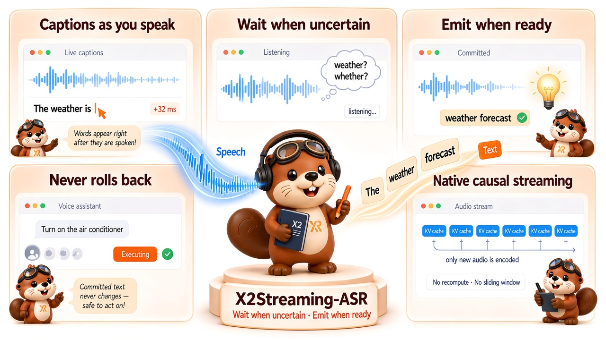
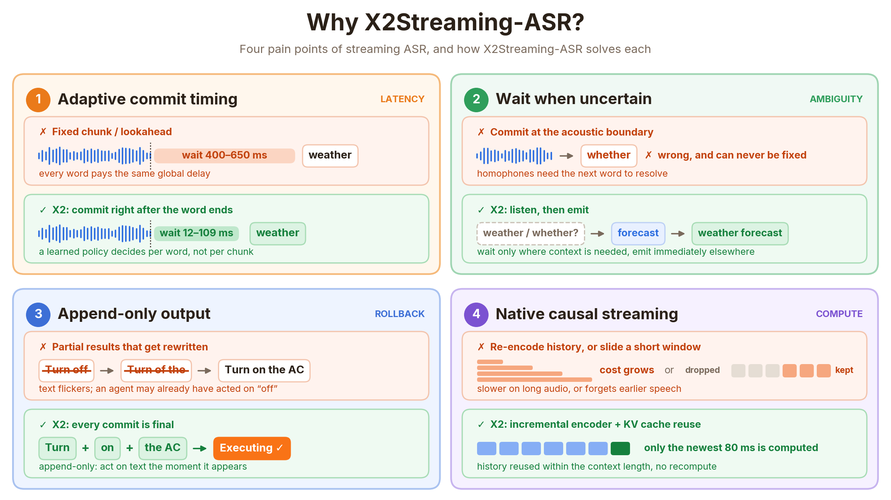
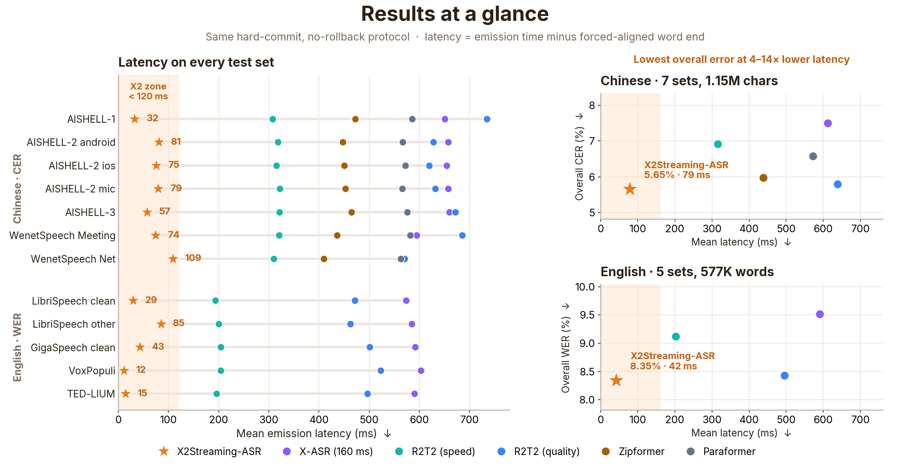
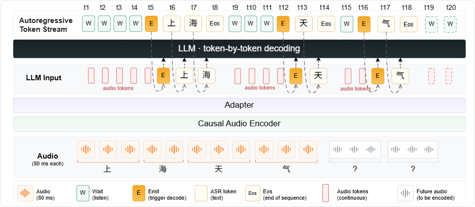

<div align="center">
  <h1>
    
    X2Streaming-ASR
  </h1>
  <p>
    <strong>Wait when uncertain, emit when ready: append-only streaming speech recognition</strong><br>
    Words appear tens of milliseconds after they are spoken, and are never taken back.
  </p>
  <p>
    <a href="https://arxiv.org/abs/2609.08672"></a>
    <a href="#-demo"></a>
    <a href="https://huggingface.co/x-square-robot/X2Streaming-ASR-4B-1009"></a>
    
    <a href="LICENSE"></a>
  </p>
</div>

**English** | [简体中文](README_zh.md)

<div align="center">
  
  <p><em>Speech flows in, final text flows out: captions appear as you speak, ambiguous words wait for context, and committed text is safe for downstream agents to act on.</em></p>
</div>

<p align="center">
  <a href="#-news">News</a> ·
  <a href="#-overview">Overview</a> ·
  <a href="#-demo">Demo</a> ·
  <a href="#-why-x2streaming-asr">Why X2</a> ·
  <a href="#-results">Results</a> ·
  <a href="#-method">Method</a> ·
  <a href="#-quick-start">Quick Start</a> ·
  <a href="#-citation">Citation</a>
</p>

---

## 🔥 News

- **[2026-09]** The paper is on arXiv: [2609.08672](https://arxiv.org/abs/2609.08672).
- **[2026-10]** Model weights on Hugging Face:
  [x-square-robot/X2Streaming-ASR-4B-1009](https://huggingface.co/x-square-robot/X2Streaming-ASR-4B-1009).

## ✨ Overview

**X2Streaming-ASR is a low-latency, append-only streaming ASR model for Chinese,
English, and code-switching speech.** On the evaluated benchmarks, it emits each
character or word with a mean latency of **only 32–109 ms in Chinese and 12–85 ms
in English** after the word ends, while achieving the best CER/WER on several test
sets.

Built on [Voxtral Mini Realtime](https://huggingface.co/mistralai/Voxtral-Mini-4B-Realtime-2602),
it splits streaming recognition into *when to commit* and *what to commit*. Every
80 ms the model chooses between **LISTEN** and **DECODE**:

- **Wait when uncertain.** If the latest audio is ambiguous, the model keeps
  listening for more context.
- **Emit when ready.** Once the context is sufficient, it decodes the new audio
  immediately.
- **Never roll back.** Output is append-only, so text is never revised after it
  appears.
- **Native causal streaming.** Only newly arrived audio is encoded, and history is
  reused through the KV cache instead of being recomputed or cut off by a sliding
  window.

This repository is **inference-only**: adaptive streaming and full-context offline
inference, Transformers and vLLM backends, JSONL batch transcription, and a web
demo.

## 🎬 Demo

*Unmute for audio.*

https://github.com/user-attachments/assets/640f5a6d-c88b-4a59-a8c9-67ef3c833464

- Colored tokens in the reference transcript identify the model that first
  produced a reliably aligned committed result: **X2** in cyan, **Qwen** in
  blue, **R2T2** in orange, and **X-ASR** in purple. Once assigned, a color
  never changes.
- The live error rate compares each model's committed output with subtitle cues
  that ended at least 1.5 seconds before the current playback position.

## 💡 Why X2Streaming-ASR?

<div align="center">
  
</div>

Fixed chunks or lookaheads make every word wait the same amount of time.
Committing exactly at the acoustic boundary gets homophones wrong. Revising
partial results makes text flicker and is unsafe for voice agents. Re-encoding the
whole history or sliding a short window either slows down on long audio or
forgets earlier speech. X2Streaming-ASR learns a per-word commit policy that
avoids all four.

## 📊 Results

<div align="center">
  
</div>

- **Lowest latency on all 12 test sets.** Mean emission latency is 12–109 ms,
  compared with 194–735 ms for the streaming baselines.
- **Best accuracy on 6 test sets.** AISHELL-1, AISHELL-3, WenetSpeech Net,
  GigaSpeech clean, VoxPopuli, and TED-LIUM.
- **Lowest overall error rate in both languages.** Pooled over all test
  utterances, X2Streaming-ASR reaches 5.65% CER on Chinese (1.15M characters)
  and 8.35% WER on English (577K words), ahead of the next best system,
  Confucius4-R2T2 (quality), at 5.79% and 8.43% with 8–12× higher latency.
  Pooled rates weight each test set by its size, so the large, harder sets
  dominate: GigaSpeech is about 70% of the English words (10.01% WER), and the
  two WenetSpeech sets are about 55% of the Chinese characters. The per-set
  averages are 4.65% CER and 5.64% WER.
- **Adaptive waiting beats fixed lookahead.** On AISHELL-1, a fixed lookahead
  needs 396 ms of mean latency to reach 1.58% CER; X2Streaming-ASR reaches 1.53%
  at 32 ms.

All systems are evaluated with a single hard commit and no rollback. Latency is
measured from the forced-aligned end of each character or word to its emission.

Chinese scores are CER (%). English scores are WER (%). Latency is in
milliseconds.

### Chinese

<div style="overflow-x:auto;">
<table>
  <thead>
    <tr>
      <th rowspan="2">Dataset</th>
      <th colspan="3" align="center">X2Streaming-ASR</th>
      <th colspan="3" align="center">X-ASR (160 ms)</th>
      <th colspan="3" align="center">Confucius4-R2T2 (speed)</th>
      <th colspan="3" align="center">Confucius4-R2T2 (quality)</th>
      <th colspan="3" align="center">Zipformer</th>
      <th colspan="3" align="center">Paraformer</th>
    </tr>
    <tr>
      <th align="right">CER</th><th align="right">Mean</th><th align="right">P95</th>
      <th align="right">CER</th><th align="right">Mean</th><th align="right">P95</th>
      <th align="right">CER</th><th align="right">Mean</th><th align="right">P95</th>
      <th align="right">CER</th><th align="right">Mean</th><th align="right">P95</th>
      <th align="right">CER</th><th align="right">Mean</th><th align="right">P95</th>
      <th align="right">CER</th><th align="right">Mean</th><th align="right">P95</th>
    </tr>
  </thead>
  <tbody>
    <tr>
      <td>AISHELL-1</td>
      <td align="right"><strong>1.53</strong></td><td align="right"><strong>32</strong></td><td align="right"><strong>320</strong></td>
      <td align="right">4.81</td><td align="right">651</td><td align="right">880</td>
      <td align="right">3.55</td><td align="right">308</td><td align="right">560</td>
      <td align="right">2.29</td><td align="right">735</td><td align="right">1280</td>
      <td align="right">1.93</td><td align="right">472</td><td align="right">800</td>
      <td align="right">3.09</td><td align="right">586</td><td align="right">880</td>
    </tr>
    <tr>
      <td>AISHELL-2 android</td>
      <td align="right">4.27</td><td align="right"><strong>81</strong></td><td align="right"><strong>400</strong></td>
      <td align="right">4.87</td><td align="right">657</td><td align="right">926</td>
      <td align="right">4.59</td><td align="right">318</td><td align="right">560</td>
      <td align="right"><strong>3.56</strong></td><td align="right">628</td><td align="right">1040</td>
      <td align="right">4.19</td><td align="right">447</td><td align="right">800</td>
      <td align="right">4.05</td><td align="right">567</td><td align="right">840</td>
    </tr>
    <tr>
      <td>AISHELL-2 ios</td>
      <td align="right">3.94</td><td align="right"><strong>75</strong></td><td align="right"><strong>400</strong></td>
      <td align="right">4.77</td><td align="right">654</td><td align="right">922</td>
      <td align="right">4.64</td><td align="right">316</td><td align="right">560</td>
      <td align="right"><strong>3.58</strong></td><td align="right">620</td><td align="right">1040</td>
      <td align="right">4.12</td><td align="right">450</td><td align="right">800</td>
      <td align="right">3.81</td><td align="right">572</td><td align="right">840</td>
    </tr>
    <tr>
      <td>AISHELL-2 mic</td>
      <td align="right">4.14</td><td align="right"><strong>79</strong></td><td align="right"><strong>480</strong></td>
      <td align="right">4.89</td><td align="right">658</td><td align="right">923</td>
      <td align="right">4.59</td><td align="right">322</td><td align="right">560</td>
      <td align="right"><strong>3.61</strong></td><td align="right">632</td><td align="right">1040</td>
      <td align="right">4.21</td><td align="right">453</td><td align="right">800</td>
      <td align="right">3.91</td><td align="right">566</td><td align="right">840</td>
    </tr>
    <tr>
      <td>AISHELL-3</td>
      <td align="right"><strong>2.08</strong></td><td align="right"><strong>57</strong></td><td align="right"><strong>400</strong></td>
      <td align="right">5.14</td><td align="right">660</td><td align="right">899</td>
      <td align="right">3.98</td><td align="right">321</td><td align="right">560</td>
      <td align="right">2.85</td><td align="right">672</td><td align="right">1120</td>
      <td align="right">2.95</td><td align="right">465</td><td align="right">800</td>
      <td align="right">3.72</td><td align="right">576</td><td align="right">849</td>
    </tr>
    <tr>
      <td>WenetSpeech Meeting</td>
      <td align="right">8.67</td><td align="right"><strong>74</strong></td><td align="right"><strong>320</strong></td>
      <td align="right">11.28</td><td align="right">595</td><td align="right">810</td>
      <td align="right">8.63</td><td align="right">320</td><td align="right">560</td>
      <td align="right"><strong>7.37</strong></td><td align="right">685</td><td align="right">1200</td>
      <td align="right">7.88</td><td align="right">436</td><td align="right">800</td>
      <td align="right">10.06</td><td align="right">582</td><td align="right">880</td>
    </tr>
    <tr>
      <td>WenetSpeech Net</td>
      <td align="right"><strong>7.88</strong></td><td align="right"><strong>109</strong></td><td align="right"><strong>400</strong></td>
      <td align="right">8.63</td><td align="right">563</td><td align="right">800</td>
      <td align="right">9.52</td><td align="right">310</td><td align="right">480</td>
      <td align="right">8.48</td><td align="right">570</td><td align="right">960</td>
      <td align="right">8.53</td><td align="right">409</td><td align="right">720</td>
      <td align="right">8.36</td><td align="right">563</td><td align="right">880</td>
    </tr>
  </tbody>
</table>
</div>

### English

<div style="overflow-x:auto;">
<table>
  <thead>
    <tr>
      <th rowspan="2">Dataset</th>
      <th colspan="3" align="center">X2Streaming-ASR</th>
      <th colspan="3" align="center">X-ASR (160 ms)</th>
      <th colspan="3" align="center">Confucius4-R2T2 (speed)</th>
      <th colspan="3" align="center">Confucius4-R2T2 (quality)</th>
    </tr>
    <tr>
      <th align="right">WER</th><th align="right">Mean</th><th align="right">P95</th>
      <th align="right">WER</th><th align="right">Mean</th><th align="right">P95</th>
      <th align="right">WER</th><th align="right">Mean</th><th align="right">P95</th>
      <th align="right">WER</th><th align="right">Mean</th><th align="right">P95</th>
    </tr>
  </thead>
  <tbody>
    <tr>
      <td>LibriSpeech test-clean</td>
      <td align="right">2.20</td><td align="right"><strong>29</strong></td><td align="right"><strong>240</strong></td>
      <td align="right">3.86</td><td align="right">574</td><td align="right">800</td>
      <td align="right">2.83</td><td align="right">194</td><td align="right">320</td>
      <td align="right"><strong>2.11</strong></td><td align="right">472</td><td align="right">800</td>
    </tr>
    <tr>
      <td>LibriSpeech test-other</td>
      <td align="right">5.50</td><td align="right"><strong>85</strong></td><td align="right">480</td>
      <td align="right">9.64</td><td align="right">585</td><td align="right">800</td>
      <td align="right">6.38</td><td align="right">201</td><td align="right"><strong>320</strong></td>
      <td align="right"><strong>4.81</strong></td><td align="right">463</td><td align="right">720</td>
    </tr>
    <tr>
      <td>GigaSpeech (clean)</td>
      <td align="right"><strong>10.01</strong></td><td align="right"><strong>43</strong></td><td align="right"><strong>320</strong></td>
      <td align="right">10.47</td><td align="right">592</td><td align="right">847</td>
      <td align="right">10.69</td><td align="right">204</td><td align="right">400</td>
      <td align="right">10.21</td><td align="right">501</td><td align="right">880</td>
    </tr>
    <tr>
      <td>VoxPopuli</td>
      <td align="right"><strong>7.07</strong></td><td align="right"><strong>12</strong></td><td align="right"><strong>320</strong></td>
      <td align="right">11.25</td><td align="right">603</td><td align="right">880</td>
      <td align="right">8.97</td><td align="right">204</td><td align="right">400</td>
      <td align="right">7.26</td><td align="right">523</td><td align="right">880</td>
    </tr>
    <tr>
      <td>TED-LIUM</td>
      <td align="right"><strong>3.42</strong></td><td align="right"><strong>15</strong></td><td align="right"><strong>240</strong></td>
      <td align="right">3.81</td><td align="right">590</td><td align="right">880</td>
      <td align="right">3.98</td><td align="right">196</td><td align="right">320</td>
      <td align="right">3.45</td><td align="right">497</td><td align="right">880</td>
    </tr>
  </tbody>
</table>
</div>

See the [paper](https://arxiv.org/abs/2609.08672) for complete benchmark
settings, baselines, and ablations.

## 🧠 Method

<div align="center">
  
  <p><em>Every 80 ms audio token, the model predicts Wait (keep listening) or Emit (start decoding). After Emit, it writes the text for the new audio and ends with Eos.</em></p>
</div>

X2Streaming-ASR keeps the causal audio encoder, adapter, and decoder-only language
model of Voxtral Realtime, but replaces its fixed delay with a learned decision:

1. **LISTEN.** For each new 80 ms audio token, predict *Wait* if the context is
   insufficient or ambiguous, or *Emit* if it is enough to commit.
2. **DECODE.** After *Emit*, generate the text for the newly heard audio until
   `Eos`, then return to LISTEN.
3. **Reuse history.** The encoder runs incrementally and the language model keeps
   its KV cache, so no chunk triggers recomputation of earlier audio. Within the
   configured context length, nothing is discarded by a sliding window.

The commit policy is trained in three stages: streaming recognition, a supervised
warm start from probed commit times, and GRPO with character-level credit
assignment that rewards accuracy first and latency second. See the
[paper](https://arxiv.org/abs/2609.08672) for details.

## 📦 Model Scope

| Item | Description |
| --- | --- |
| Base model | Voxtral Mini Realtime |
| Languages | Chinese, English, and code-switching |
| Streaming output | Append-only hard commits |
| Inference modes | Adaptive streaming and full-context offline |
| Backends | Transformers and vLLM |
| Model weights | [x-square-robot/X2Streaming-ASR-4B-1009](https://huggingface.co/x-square-robot/X2Streaming-ASR-4B-1009) |

## 🚀 Quick Start

### 1. Install

Linux, Python 3.11, and a CUDA-compatible NVIDIA GPU are recommended.

```bash
git clone https://github.com/ZwlinZw/X2StreamingASR.git
cd X2StreamingASR

conda create -n x2streamingasr python=3.11 -y
conda activate x2streamingasr
pip install -r requirements.txt
```

Install optional vLLM and web-demo dependencies when needed:

```bash
pip install -r requirements-vllm.txt -r demo/requirements.txt
```

### 2. Model

Model weights are on Hugging Face:
[x-square-robot/X2Streaming-ASR-4B-1009](https://huggingface.co/x-square-robot/X2Streaming-ASR-4B-1009).

Download and set `MODEL_PATH`:

```bash
pip install -U huggingface_hub

huggingface-cli download x-square-robot/X2Streaming-ASR-4B-1009 --local-dir ./X2Streaming-ASR-4B-1009
export MODEL_PATH="$(pwd)/X2Streaming-ASR-4B-1009"
```

Or use any local checkpoint directory:

```bash
export MODEL_PATH=/path/to/X2Streaming-ASR-4B-1009
```

### 3. Streaming and offline inference

```bash
# Adaptive streaming
python infer.py \
  --config configs/infer.yaml \
  --model_path "$MODEL_PATH" \
  --language zh \
  --audio /path/to/audio.wav

# Full-context offline
python infer.py \
  --config configs/infer_offline.yaml \
  --model_path "$MODEL_PATH" \
  --language en \
  --audio /path/to/audio.wav
```

> [!IMPORTANT]
> **Set `--language` to match your audio.** The model is conditioned on a
> language tag: `zh` for Chinese, `en` for English, and `cs` for
> Chinese-English code-switching. Without `--language`, the tag is guessed from
> the input path and falls back to `zh` unless the path contains
> `librispeech`, `gigaspeech`, `tedlium`, or `voxpopuli`, so English audio
> should always be run with `--language en`. One tag is used for the whole run,
> so split mixed-language JSONL files by language or use `cs`.

### 4. JSONL batch inference

Each input line must contain one of `audio`, `wav`, or `wav_path`:

```json
{"audio": "/path/to/first.wav"}
{"wav": "/path/to/second.wav"}
```

```bash
python infer.py \
  --config configs/infer.yaml \
  --model_path "$MODEL_PATH" \
  --language en \
  --input_file audio.jsonl \
  --output_file results.jsonl
```

The output JSONL contains the audio path, recognized text, inference mode, and
optional timestamps or adaptive emit records. A reference transcript is not
required.

### 5. Web demo

```bash
BACKEND=transformers \
MODE=adaptive \
LANGUAGE=zh \
REPO_ID="$MODEL_PATH" \
bash demo/run.sh
```

Open `http://localhost:7860`. `LANGUAGE` sets the default language tag (`zh`,
`en`, or `cs`; default `zh`); use `LANGUAGE=en` for English speech.

For vLLM, convert and serve the model first:

```bash
python tools/convert_hf_to_mistral.py "$MODEL_PATH"

vllm serve "$MODEL_PATH" \
  --host 0.0.0.0 \
  --port 8000 \
  --tokenizer-mode mistral \
  --config-format mistral \
  --enforce-eager \
  --gpu-memory-utilization 0.9
```

Then launch the demo proxy:

```bash
BACKEND=vllm \
MODE=adaptive \
LANGUAGE=zh \
VLLM_HOST=127.0.0.1 \
VLLM_PORT=8000 \
REPO_ID="$MODEL_PATH" \
bash demo/run.sh
```

## 📝 Citation

If X2Streaming-ASR is useful for your research, please cite:

```bibtex
@article{lin2026x2streaming,
  title={X2Streaming-ASR: wait when uncertain, emit when ready for streaming ASR},
  author={Lin, Zhiwei and Fu, Kaiqi and Wen, Rime and Liu, Zehan and Qin, Shawn and Gan, Roy and Wang, Hao and Wang, Qian},
  journal={arXiv preprint arXiv:2609.08672},
  year={2026}
}
```

## 📄 License

- Source code: [Apache License 2.0](LICENSE)
- Model weights: see [MODEL_LICENSE.md](MODEL_LICENSE.md)
- Upstream model:
  [mistralai/Voxtral-Mini-4B-Realtime-2602](https://huggingface.co/mistralai/Voxtral-Mini-4B-Realtime-2602)
